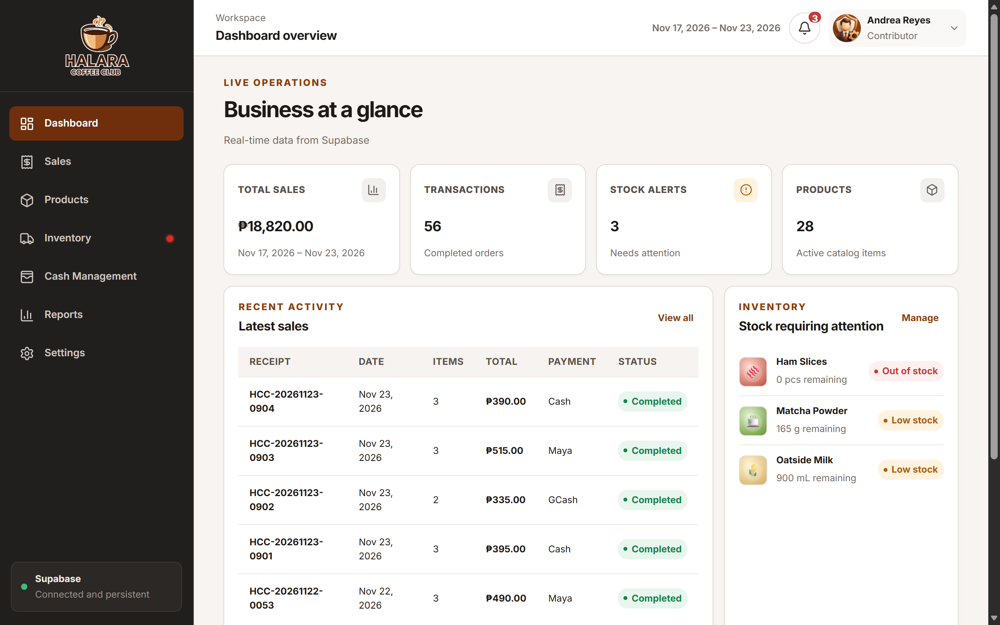
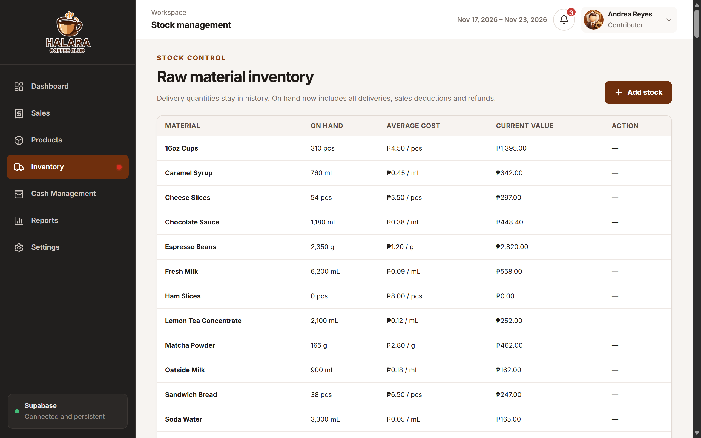
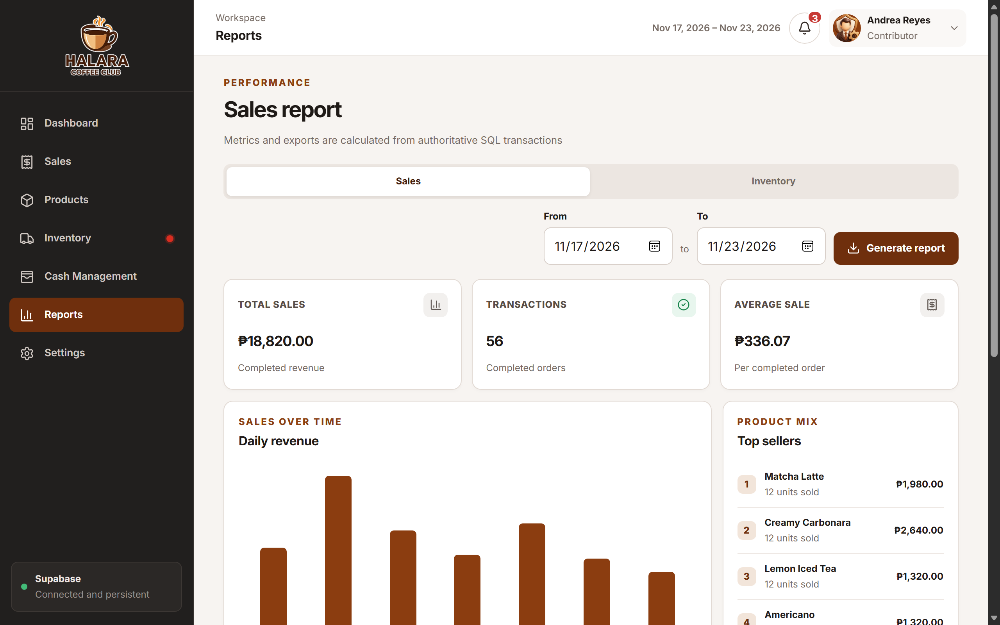
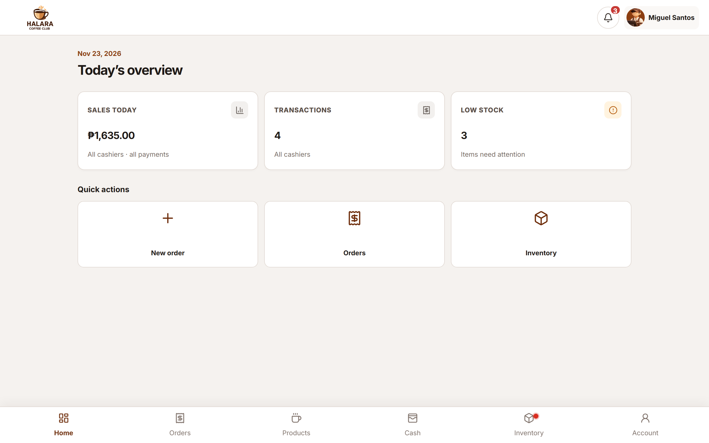
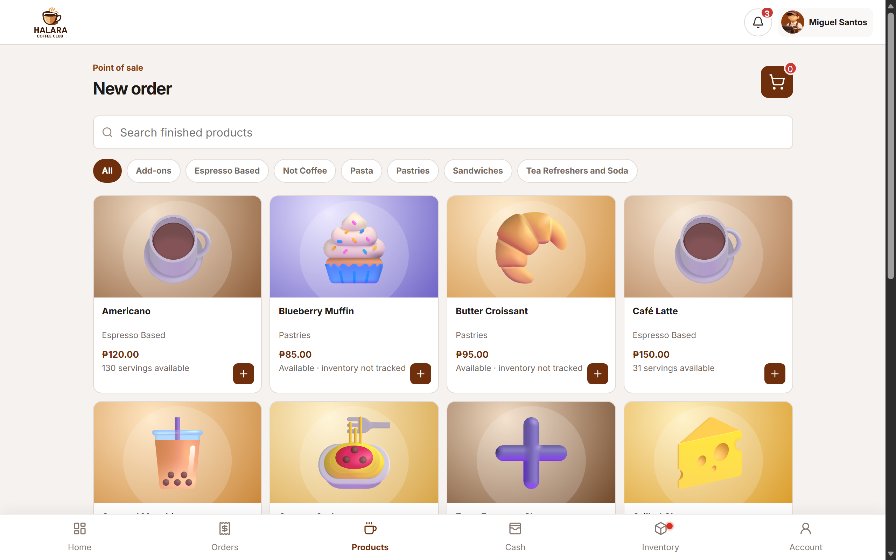
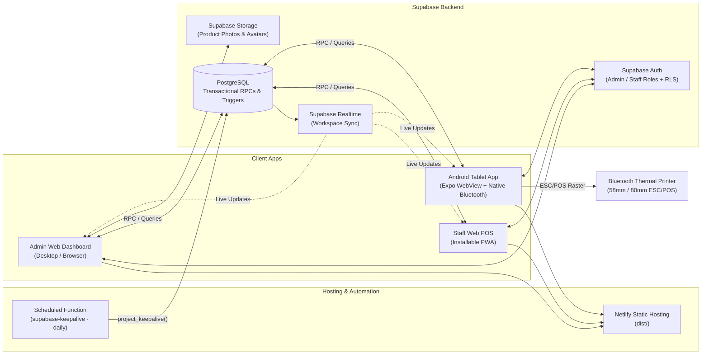
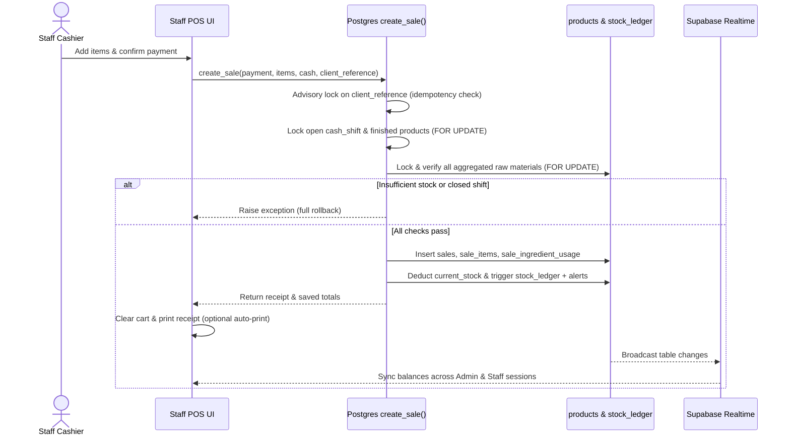

# Halara Coffee Club — POS & Inventory System

A full-stack Point of Sale (POS), recipe-driven inventory, cash-shift reconciliation, and reporting system built for **Halara Coffee Club**.

It combines a responsive TypeScript/HTML/CSS web application (installable as a PWA), an optional Android tablet WebView wrapper with native Bluetooth thermal receipt printing, and a Supabase PostgreSQL backend enforcing row-level security, transactional stock deduction, and real-time workspace synchronization.

---

## Table of Contents

- [Features](#features)
- [Screenshots](#screenshots)
- [System Architecture & Diagrams](#system-architecture--diagrams)
- [Tech Stack & Project Structure](#tech-stack--project-structure)
- [Supabase Setup & Migrations](#supabase-setup--migrations)
- [Local Development & Validation](#local-development--validation)
- [Deployment (Netlify & Keep-Alive)](#deployment-netlify--keep-alive)
- [Mobile PWA & Thermal Receipt Printing](#mobile-pwa--thermal-receipt-printing)

---

## Features

### Admin Workspace
- **Live Dashboard** — Real-time sales totals, completed transaction counts, low-stock/out-of-stock alerts, and recent receipts.
- **Catalog & Recipe Management** — Separates sellable finished products from stocked raw materials, with per-serving ingredient recipes and category-based tracking scope (`Pastries` and `Pasta` excluded from stock deduction).
- **Raw Material Inventory & Stock Ledger** — Unit-safe stock intake (`g` ↔ `kg`, `mL` ↔ `L` conversion), weighted-average unit costing, delivery edits/deletions that preserve sales deductions, and an append-only **Stock In / Out History** ledger with running balances.
- **Cash Management** — Monitor all open and closed cashier shifts, inspect Cash In/Out movements and variance, or force-close abandoned shifts with an audit note.
- **Sales & Inventory Reports** — Date-filtered revenue charts, top-selling products, payment breakdowns, stock valuation, ingredient consumption, alert history, and **PDF / CSV exports**.
- **Digital Payment QR Settings** — Upload, auto-crop, and manage shared **GCash** and **Maya** payment QRs across all devices.

### Staff POS Workspace
- **Shift-Gated Checkout** — Cashiers open a shift with a starting drawer balance before taking Cash, GCash, or Maya orders.
- **Live Availability & Atomic Deduction** — Menu availability is computed from raw-material stock; completing an order deducts all shared recipe ingredients atomically and prevents duplicate submissions via idempotent client references.
- **Cash & Digital Payments** — Quick tender buttons, automatic change calculation, GCash/Maya QR display with manual confirmation, and safe refund/restore controls.
- **Thermal Receipt Printing** — Dual-copy (Customer + Store) 58mm/80mm receipts via browser print dialog or direct Bluetooth ESC/POS printing in the Android tablet app.
- **Live Stock Visibility** — Real-time raw material status and low-stock navigation indicators synchronized through Supabase Realtime.

---

## Screenshots

### Admin Dashboard

| Dashboard Overview | Raw Material Inventory & Valuation |
| :---: | :---: |
|  |  |

| Sales & Inventory Reports |
| :---: |
|  |

### Staff POS Workspace

| Staff Home — Today's Overview | Staff POS — New Order Menu |
| :---: | :---: |
|  |  |

---

## System Architecture & Diagrams

### High-Level Architecture



### Atomic Sale & Inventory Deduction Flow



---

## Tech Stack & Project Structure

- **Frontend**: TypeScript, Vite, vanilla HTML/CSS, Lucide icons, `jsPDF` (PDF reports), `jsQR` (QR detection & cropping)
- **Backend**: Supabase (Auth, PostgreSQL RPCs, Triggers, Row-Level Security, Realtime, Storage)
- **Mobile Wrapper**: Expo / React Native WebView with custom Android Bluetooth thermal printer module (`mobile/`)
- **Testing**: Node.js built-in test runner (`node --test`) + `@electric-sql/pglite` for isolated PostgreSQL migration & RPC tests

```text
POS-InventorySystem/
├── assets/                   # Brand logo, role artwork, payment icons
├── docs/
│   ├── screenshots/          # Admin & Staff UI screenshots
│   ├── inventory-safety.md   # Inventory accuracy & unit-integrity notes
│   └── payment-qr.md         # GCash & Maya QR architecture notes
├── mobile/                   # Android tablet WebView + native Bluetooth printer app
├── netlify/functions/        # Daily Supabase Free Plan keep-alive function
├── public/                   # PWA manifest, service worker, app icons, print assets
├── shared/                   # Typed WebView ↔ native printer bridge protocol
├── src/
│   ├── api.ts                # Supabase client, paginated queries, reports, exports
│   ├── app.ts                # Admin dashboard & Staff POS UI
│   ├── inventory-quantity.ts # Unit conversion & quantity validation helpers
│   ├── native-pos.ts         # Native Android printer bridge client
│   ├── payment-qr.ts         # QR detection & white-border auto-cropping
│   ├── receipt-printing.ts   # Print lifecycle isolation for thermal roll media
│   └── styles.css            # Application theme & responsive layout
├── supabase/
│   ├── migrations/           # Numbered SQL migrations (001–014)
│   ├── setup-users.sql       # Role assignment for Admin & Staff accounts
│   └── testing/              # Non-production deterministic test seed
└── tests/                    # Automated unit, checkout, QR, printer & PGlite SQL tests
```

---

## Supabase Setup & Migrations

1. Open the **Supabase SQL Editor** for your project.
2. Run the SQL migrations in `supabase/migrations/` in **numeric order** (existing deployments only need to run migrations newer than what is already applied):

| # | Migration File | Summary |
| :---: | :--- | :--- |
| 001 | `001_initial.sql` | Core schema (`profiles`, `categories`, `products`, `inventory_movements`, `sales`, `sale_items`, `notifications`), RLS, storage buckets, base RPCs |
| 002 | `002_product_recipes.sql` | Separates `raw_material` vs `finished_product`, adds `product_recipes` & `sale_ingredient_usage`, atomic ingredient deduction |
| 003 | `003_default_menu.sql` | Seeds default Halara Coffee Club categories and menu items (without stock photos or guessed recipes) |
| 004 | `004_allow_draft_finished_products.sql` | Allows saving finished product details & photos before recipes are configured |
| 005 | `005_inventory_tracking_scope.sql` | Introduces category-level inventory tracking flag and sale-item tracking snapshots |
| 006 | `006_cash_reporting_realtime.sql` | Adds cashier shifts, Cash In/Out movements, weighted-average raw-material costing, idempotent `create_sale`, and Realtime publication |
| 007 | `007_fix_create_sale_ambiguous_id.sql` | Qualifies column identifiers inside `create_sale` RPC |
| 008 | `008_correct_inventory_tracking_scope.sql` | Final tracking scope: excludes only `Pastries` and `Pasta`; tracks Espresso Based, Not Coffee, Tea Refreshers & Soda, Sandwiches, and Add-ons |
| 009 | `009_project_keepalive.sql` | Adds read-only `project_keepalive()` RPC for the daily Netlify keep-alive job |
| 010 | `010_gcash_payment_qr.sql` | Adds `payment_settings` table and admin RPC for shared GCash QR |
| 011 | `011_maya_payment_qr.sql` | Extends `payment_settings` and adds unified `set_payment_qr()` for GCash and Maya |
| 012 | `012_preserve_inventory_units.sql` | Trigger preventing unit relabelling (`g` ↔ `kg`, `mL` ↔ `L`) once stock, recipes, or history exist |
| 013 | `013_stock_ledger.sql` | Creates append-only `stock_ledger` table, triggers, historical reconstruction, RLS, and Realtime publication |
| 014 | `014_cash_refund_guard.sql` | Locks cash shift row and blocks Cash refunds that would make expected drawer cash negative |

3. In **Authentication → Users**, create the initial accounts (change default passwords after first login):
   - Admin: `r.constante.dev@gmail.com` / `Admin@12345!`
   - Staff: `staff@halara.test` / `Staff@12345!`
4. Run [`supabase/setup-users.sql`](supabase/setup-users.sql) in the SQL Editor to assign `admin` and `staff` roles.

> **Staging / Test Seed Only:** For a non-production test database, you may optionally run [`supabase/testing/seed_inventory_recipes.sql`](supabase/testing/seed_inventory_recipes.sql) after migrations `001`–`008` to load sample ingredients and recipes. Do **not** run it on production.

---

## Local Development & Validation

```sh
npm install
npm run dev
```

Open `http://127.0.0.1:5173`.

To connect to your own Supabase project, copy `.env.example` to `.env.local` and set:

```env
VITE_SUPABASE_URL=https://your-project.supabase.co
VITE_SUPABASE_PUBLISHABLE_KEY=your-publishable-key
```

> Never put a Supabase `service_role` key in the frontend or any `VITE_` variable.

### Typecheck, Build & Automated Tests

```sh
npm run typecheck
npm run build
node --test tests/*.test.mjs
```

The test suite runs **39 automated tests** covering checkout idempotency, cart clearing, GCash/Maya QR validation & cropping, stock unit conversions, native Bluetooth bridge security, and live SQL execution in PGlite (`add_stock`, `update_stock_entry`, `delete_stock_entry`, `create_sale`, `set_sale_status`, `preserve_inventory_unit`, `stock_ledger`, and cash refund guards).

---

## Deployment (Netlify & Keep-Alive)

The repository includes [`netlify.toml`](netlify.toml) configured for automatic builds:

- **Build command**: `npm run build`
- **Publish directory**: `dist`

### Supabase Free Plan Keep-Alive
The scheduled Netlify function [`netlify/functions/supabase-keepalive.mjs`](netlify/functions/supabase-keepalive.mjs) runs daily at `03:17 UTC` and calls the read-only `project_keepalive` RPC to prevent Free Plan inactivity pauses.

1. Set `VITE_SUPABASE_URL` and `VITE_SUPABASE_PUBLISHABLE_KEY` in **Netlify → Project configuration → Environment variables**.
2. Ensure migration `009_project_keepalive.sql` is applied.
3. Verify once via **Netlify → Functions → supabase-keepalive → Run now**.

---

## Mobile PWA & Thermal Receipt Printing

### Install as a Progressive Web App (PWA)
Both Admin and Staff workspaces live in the same responsive web app:
- **Android Chrome**: Sign in and tap **Add POS to home screen**, or open Chrome's menu → **Install app**.
- **iOS Safari**: Tap **Share** → **Add to Home Screen**.

### Thermal Receipt Printing (Web & Android Tablet)
- **Web / PWA**: Clicking **Print receipt** opens the OS print dialog using an isolated print snapshot so background Realtime refreshes cannot interrupt printing. Supports 58mm and 80mm roll media.
- **Android Tablet App (`mobile/`)**: Wraps the Staff POS in a locked-down WebView with a native Bluetooth ESC/POS raster module (`HalaraPrinterModule`) for direct one-tap printing to paired thermal printers (e.g., RP30A-UB). See [`mobile/README.md`](mobile/README.md) for APK build details.
- **Printer Diagnostics**: Open `/print-check.html` on the deployed site to run an isolated 58mm test job with browser print-lifecycle diagnostics.
